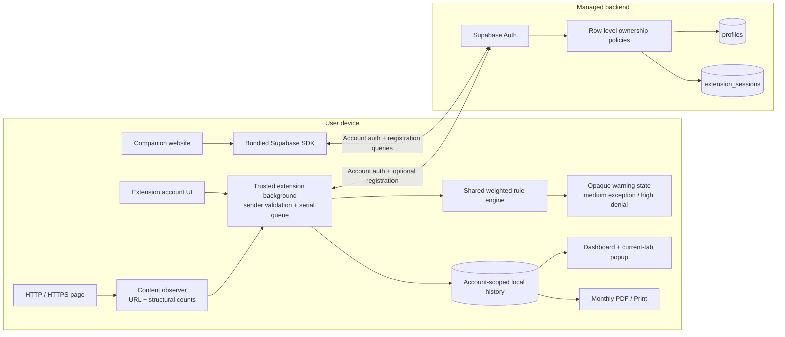
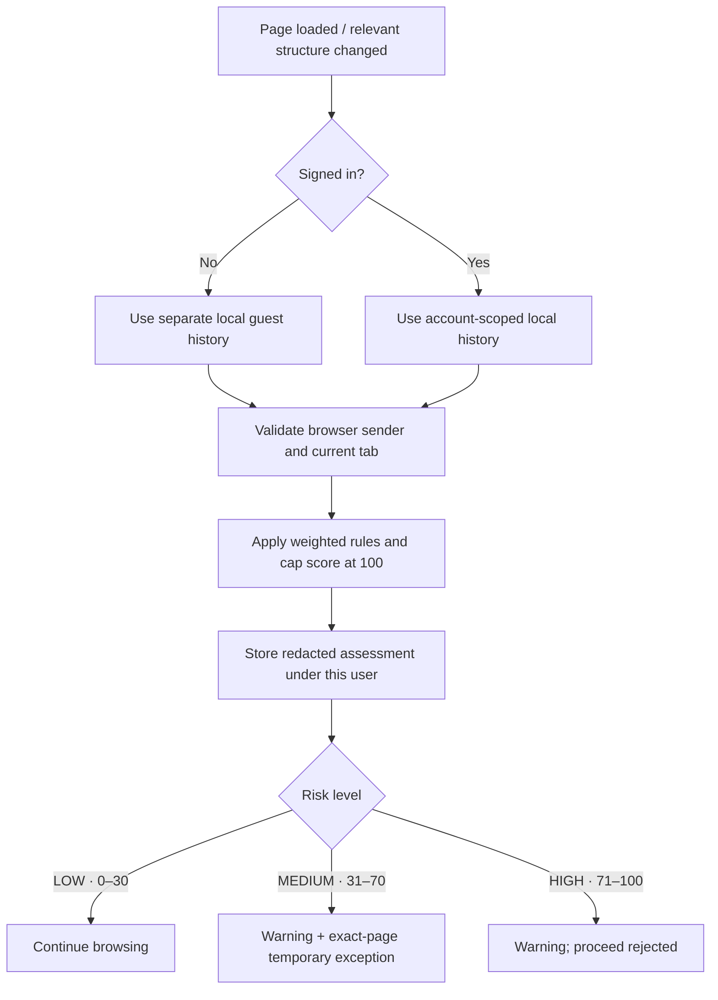
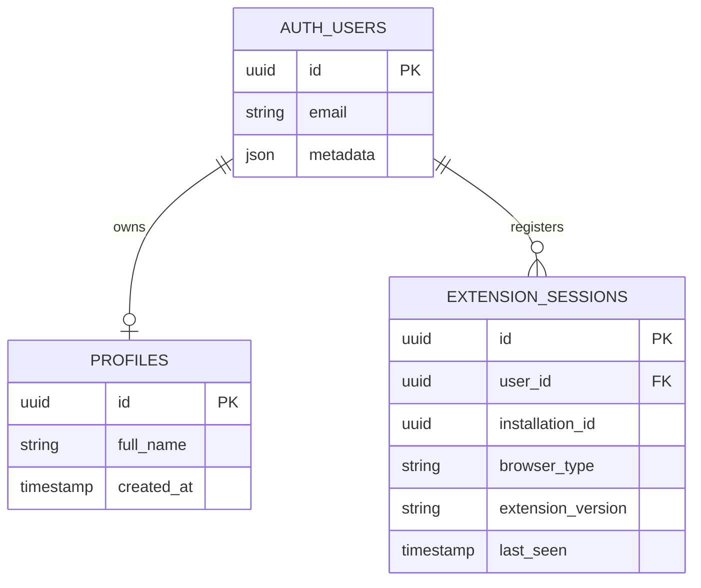

<div align="center">

**Explainable browser risk assessments. Private, on-device history.**

[](https://github.com/hossain0707/PhishGuard/actions/workflows/ci.yml)


[**Live website**](https://phishgurd.vercel.app/) · [**Edge ZIP**](https://phishgurd.vercel.app/downloads/PhishGuard-Chrome-Edge.zip) · [**Firefox ZIP**](https://phishgurd.vercel.app/downloads/PhishGuard-Firefox.zip) · [**Privacy policy**](https://phishgurd.vercel.app/privacy.html)

[Overview](#overview) · [Live status](#release-and-store-status) · [Screenshots](#demo-and-screenshots) · [Architecture](#architecture) · [Install](#installation-and-quick-start) · [Evaluation](#verification-and-evidence) · [Docs](#documentation)

</div>

---

## Overview

**PhishGuard** is a browser extension and companion website developed for a Final Year Project (FYP). It checks HTTP/HTTPS URL characteristics and limited page-structure signals, explains a heuristic risk score and shows controlled warnings for suspicious pages. It also provides account-separated **local** assessment history, a dashboard and monthly PDF reports.

- **Account optional:** basic risk scanning, warnings and local reports work in guest mode.
- **Transparent decisions:** see the factors behind LOW, MEDIUM and HIGH assessments.
- **One source codebase:** build dedicated packages for Microsoft Edge/Chrome and Firefox.
- **Privacy-oriented:** passwords, form values and page text are not read; browsing assessment history is not sent to Supabase.
- **Companion website:** optional signup, login, account profile and browser-registration information, hosted on Vercel.

> [!IMPORTANT]
> PhishGuard is an **academic, rule-based prototype**, not a certified anti-phishing product. Scanning occurs **after page load**, scores are not probabilities, and false positives/negatives are possible. A LOW score or HTTPS address does not guarantee safety. Do not rely on it as your only security control.

## Release and store status

| Component                                       | Current state               | Notes                                                                                                            |
| ----------------------------------------------- | --------------------------- | ---------------------------------------------------------------------------------------------------------------- |
| [Public website](https://phishgurd.vercel.app/) | **Live**                    | Vercel Hobby deployment with HTTPS                                                                               |
| Supabase backend                                | **Provisioned**             | Free project; `profiles` and `extension_sessions` with row-level security                                        |
| Website account login                           | **Observed working**        | Sign-in and dashboard shown in live testing; comprehensive email/recovery and cross-account checks still pending |
| Microsoft Edge Add-ons                          | **Submitted — in review**   | Version `4.2.0` shown as _In review_ in Partner Center on **13 October 2026**; no public listing URL yet         |
| Mozilla Firefox Add-ons                         | **Prepared, not submitted** | Firefox build available; developer account ready, marketplace upload/review still pending                        |
| Chrome Web Store                                | **Not submitted**           | Separate developer registration and review would be required                                                     |

**Last externally observed store status: 13 October 2026 (v4.1.0).** The v4.2.0 code is a new development candidate, not that approved or in-review package. Microsoft/Firefox certification status can change; this README is a dated snapshot, not a live store API. The Edge and Firefox ZIP links above are **development packages** (their version depends on the currently deployed build), not approved store installations. Until official listings are approved, there are no official install buttons to link.

The requested marketplace publisher display name is **Norah Jasmine**, distinct from the GitHub repository owner. Mozilla and Microsoft manage publisher identity and certification independently. An operator support/account-deletion contact, live email delivery checks, real-browser smoke tests, independent risk evaluation and any permitted GMI artwork remain release requirements. See [release readiness](docs/RELEASE-READINESS.md) and [marketplace preparation](docs/STORE-SUBMISSIONS.md).

## What is implemented

| Capability            | Behaviour                                                                                                                                       |
| --------------------- | ----------------------------------------------------------------------------------------------------------------------------------------------- |
| Account onboarding    | Optional signup, email-verification requirement, login, profile editing and website password recovery                                           |
| Session handling      | Official Supabase SDK refresh; extension credentials in trusted browser-session storage; local cleanup even when logout cannot reach the server |
| Automatic assessments | Page-load scan, relevant DOM-change reassessment and URL-change polling with bounded work                                                       |
| Explainable rules     | Weighted indicators, documented thresholds and human-readable reasons                                                                           |
| Controlled warnings   | Medium risk permits an exact-page, per-tab five-minute exception; high-risk proceed requests are rejected by the background                     |
| Account privacy       | Local histories keyed by authenticated user ID; browser-registration rows protected by ownership policies                                       |
| Review and reporting  | Current-tab popup, recent-activity dashboard, month selection, paginated PDF download and a Unicode-preserving Print alternative                |
| Reproducible delivery | Locked dependencies, one build pipeline, matching package contents, SHA-256 checksums and locally bundled executable dependencies               |
| Repository quality    | Pinned CI actions, formatting checks, dependency updates, security guidance and controlled browser/accessibility checks                         |

## Demo and screenshots


The animation cycles through **real application screenshots** captured with synthetic accounts and harmless fixtures. It is not a recording of live threats, real user histories or production accuracy. SVG animations respect reduced-motion preferences; the static screenshots remain available below.

<table>
<tr>
<td width="50%"><strong>Private activity dashboard</strong><br></td>
<td width="50%"><strong>Validated high-risk warning</strong><br></td>
</tr>
<tr>
<td><strong>Readable monthly report</strong><br></td>
<td><strong>Account onboarding</strong><br></td>
</tr>
</table>

Recreate the screenshots and animation with `npm run demo`. The script uses a temporary browser profile, isolated mocked Supabase and eight automated desktop accessibility checks. No live accounts or cloud records are created.

[Presentation walkthrough](docs/DEMO.md) · [Website screenshot](docs/assets/website.png) · [Medium warning](docs/assets/warning-medium.png) · [Account portal](docs/assets/account.png)

## Architecture



**Browsing history stays on the device.** Supabase manages account information and recorded browser registrations; it does not receive the local visit log. The website and extension use the same account backend but maintain separate login sessions.

### Assessment lifecycle



The background owns privileged operations and warning destinations. Query-string claims cannot change a warning's risk level or target. Content scripts receive no session tokens and privileged account messages require an extension-origin sender.

### Account data



Supabase Auth manages passwords; application tables do not duplicate them. Registration upserts use the user/installation pair. `last_seen` represents recorded login/registration activity, **not a live browser connection**. [Trust boundaries and rule rationale →](docs/ARCHITECTURE.md)

## Installation and quick start

### Try the live website

Open **[phishgurd.vercel.app](https://phishgurd.vercel.app/)** to explore the public portal, account pages and download links. The website alone **cannot monitor arbitrary browser tabs**; monitoring requires installing the desktop extension.

### Install the desktop extension locally

Store approval is **not required** for development or an FYP demonstration.

| Browser                       | Package / build folder                                                               | How to load for testing                                                                                                                     |
| ----------------------------- | ------------------------------------------------------------------------------------ | ------------------------------------------------------------------------------------------------------------------------------------------- |
| **Microsoft Edge**            | [Chrome/Edge ZIP](https://phishgurd.vercel.app/downloads/PhishGuard-Chrome-Edge.zip) | Extract ZIP → open `edge://extensions` → enable **Developer mode** → **Load unpacked** → choose extracted folder containing `manifest.json` |
| **Google Chrome (desktop)**   | Same Chrome/Edge ZIP                                                                 | Extract ZIP → `chrome://extensions` → **Developer mode** → **Load unpacked**                                                                |
| **Mozilla Firefox (desktop)** | [Firefox ZIP](https://phishgurd.vercel.app/downloads/PhishGuard-Firefox.zip)         | Extract ZIP → `about:debugging#/runtime/this-firefox` → **Load Temporary Add-on** → select `manifest.json`                                  |

Firefox temporary add-ons are normally removed after a restart. Permanent Firefox distribution requires Mozilla signing. These local procedures are for development/testing, not marketplace certification. **Firefox Android is a compatibility candidate and still requires a real-device test and Mozilla signing.** Standard Chrome mobile and Safari iOS are not supported extension targets. iPhone users can instead use the manual [PhishGuard web URL checker](https://phishgurd.vercel.app/) after the new website deployment. A phone can display the website, not the desktop extension.

Once installed, open the extension and choose **Continue with local protection (no account)**. Open or reload a test HTTP/HTTPS page, then inspect the extension popup, warning page, local dashboard and monthly report. To test account-specific features, use a verified account and a correctly configured Supabase service.

### Run from source

Requirements: **Node.js 22+**, npm, Git and a desktop browser.

```bash
git clone https://github.com/hossain0707/PhishGuard.git
cd PhishGuard
npm ci --include=dev
npm run build
npm test
npm run serve
```

Open **http://127.0.0.1:4173** to preview the website. The build also produces `dist/chrome-edge/` and `dist/firefox/` for unpacked browser testing, plus downloadable ZIPs and SHA-256 hashes under `website/downloads/`. Generated artifacts are ignored by Git and should not be committed as parallel source copies.

### Configure an independent Supabase deployment

The existing production website uses an active Supabase project and its public client key. **You do not need to create another Supabase project to try PhishGuard.** For your own separate deployment, copy `.env.example` to `.env` and set:

```dotenv
PHISHGUARD_SUPABASE_URL=https://YOUR-PROJECT.supabase.co
PHISHGUARD_SUPABASE_PUBLISHABLE_KEY=sb_publishable_YOUR_PUBLIC_CLIENT_KEY
PHISHGUARD_WEBSITE_URL=https://YOUR-PROJECT.vercel.app/
```

Rebuild the extension and website after changing these values. Review [the migration](database/001_accounts.sql), configure Supabase Auth Site URL and redirect allowlist, set up production email delivery as needed, and verify row-level security with two separate test users.

**Never embed a Supabase secret/service-role key, passwords or private `.env` files into browser bundles or Git.** [Full setup guide](docs/SETUP.md) · [Free deployment guide](docs/DEPLOY-VERCEL-FREE.md).

## Detection model

PhishGuard 4.2.0 focuses on **credential phishing** and **brand impersonation** using four explainable evidence stages, not one keyword rule: URL structure → domain verification → credential-form indicators → optional reputation evidence. Each result contains the triggered stages and human-readable reasons.

| Prototype indicator                             |           Weight | Interpretation                                                   |
| ----------------------------------------------- | ---------------: | ---------------------------------------------------------------- |
| Unencrypted HTTP                                |              +12 | Transport warning, **not** proof of phishing                     |
| IP address hostname                             |              +20 | Context indicator, including ordinary local testing              |
| Keyword in URL path/query                       |               +6 | Weak signal; by itself remains LOW                               |
| Lookalike / deceptive brand label               |              +40 | Potential brand impersonation; manually reviewed roots           |
| Password form on HTTP                           |              +35 | Sensitive input on insecure transport                            |
| Cross-origin password-form action               |              +20 | May be legitimate SSO; review with other signals                 |
| More than three iframes / five forms            |          +6 each | Weak page-structure signals                                      |
| Verified third-party malicious reputation match | Minimum score 90 | **Optional**, only after user consent and provider configuration |

The thresholds remain **LOW 0–30 · MEDIUM 31–70 · HIGH 71–100** as provisional FYP cutoffs, not probabilities. A Google Safe Browsing lookup is **OFF by default** and uses a server-side key only if an eligible operator configures `PHISHGUARD_SAFE_BROWSING_KEY`; errors and no matches never lower local risk. URLs are sent to the operator website and Google **only with consent**. The URL-only mobile checker cannot inspect real webpage forms.

**Research supports examining these features, not these particular numeric weights.** See [Lecturer improvements and research references](docs/LECTURER-IMPROVEMENTS.md) for 3 academic/standards sources per category and the holdout-evaluation plan. The 10-fixture synthetic test is for logic, not measured real-world detection accuracy. A trusted-looking or HTTPS page can still be malicious.

## Privacy and security

- No password values, form contents or page text are captured.
- Persisted assessment URLs omit credentials, query strings and fragments; paths may still contain personal information.
- Rolling scan history is local and account-separated, bounded to 5,000 assessments / 366 days. An independent on-device IndexedDB archive preserves recorded monthly scans until explicit deletion or browser-storage removal; storage quota still applies.
- Dashboard Clear preserves report history; explicit month deletion and account-history erasure remove owned records.
- Extension tokens live in browser-session storage; restarting the browser requires login. Website sessions use local browser storage.
- Cloud account tables use owner-based RLS. Firefox browser metadata registration requires optional technical-data consent.
- Logout clears local credentials even when remote cleanup fails; offline cleanup does not prove server-side session revocation.
- Exported PDFs remain separate files until the user deletes them.
- Optional third-party reputation checks require opt-in and a configured noncommercial API key; they send the checked URL outside the device. Off by default.

The extension can scan in guest mode when authentication is unavailable. Guest history uses its own on-device owner key and is not silently merged into an account. The extension requests `storage`, `tabs` and HTTP/HTTPS site access. Executable dependencies are bundled locally; extension pages use a restrictive CSP and are not exposed as web-accessible account pages.

[Security reporting](SECURITY.md) · [Product privacy disclosure](website/privacy.html) · [Release requirements](docs/RELEASE-READINESS.md)

## Verification and evidence

```bash
npm run check
npm audit --omit=dev
npm run evaluate
npm run demo
```

Windows browser checks default to installed Edge. On Linux/macOS, install Playwright Chromium:

```bash
npx playwright install --with-deps chromium
```

Override the selected browser with `TEST_BROWSER_CHANNEL` when needed.

| Layer                | Coverage                                                                                                                                    | Evidence boundary                                            |
| -------------------- | ------------------------------------------------------------------------------------------------------------------------------------------- | ------------------------------------------------------------ |
| Unit / integration   | Rule boundaries, redaction, retention, month selection, PDF pagination, SDK refresh/revocation, offline logout and safe build configuration | Local code behaviour                                         |
| Database             | Actual SQL/RLS in local PostgreSQL-compatible PGlite, including two-account denials and pre-existing permissive policies                    | Migration logic; deployed Supabase must be tested separately |
| Browser              | Signup/login, recovery, dynamic reassessment, warnings, ownership, deletion, PDFs and responsive layout                                     | Real browser UI with mocked Supabase                         |
| Accessibility        | Eight controlled desktop screens checked with axe WCAG A/AA tags                                                                            | Automated checks, not a complete accessibility certification |
| Package / repository | ZIP entries match generated sources; outputs, dependencies and private environment files stay out of Git                                    | Reproducible delivery                                        |
| CI                   | Formatting, build, tests, Firefox validation, browser scenarios, demo checks and production dependency audit                                | Remote run status available in the repository Actions tab    |

The GitHub workflow uses pinned action revisions, read-only job permissions and CI logs (artifact uploads disabled while quota is exhausted). Dependency updates are proposed through Dependabot. No live credentials are required by CI.

## Repository layout

```text
PhishGuard/
├── extension/
│   ├── src/               Background and extension-page logic
│   ├── pages/             Maintained HTML/CSS templates
│   ├── assets/            Store-size icons
│   └── manifest.json      Browser manifest template
├── website/
│   ├── src/               Authored website behaviour
│   └── …                  Maintained pages and visual assets
├── shared/                Auth, rules, history, logout, PDFs and config
├── database/              Reviewed SQL migrations
├── docs/                  Architecture, evidence, demo and operations
├── tests/                 Controlled automated verification
├── tools/                 Build, demo, server and evaluation helpers
├── .github/               CI, dependency updates and PR guidance
├── .env.example           Public-client configuration template
├── package-lock.json      Reproducible dependency versions
└── vercel.json            Root deployment configuration
```

`dist/`, `node_modules/`, `test-results/` and generated website bundles/downloads are excluded from Git. Build produces browser packages in `dist/chrome-edge` and `dist/firefox`, plus website ZIP downloads and SHA-256 checksums. **Do not maintain a second copy or upload source ZIPs as the repository.**

## Deployment

The last verified public website is **[https://phishgurd.vercel.app/](https://phishgurd.vercel.app/)** (the assigned Vercel project/domain uses the spelling `phishgurd`). The deployment uses the repository's root `vercel.json`, which builds the `website/` output from the same source as both extension packages.

| Layer                                     | Technology                 | Deployment notes                                                         |
| ----------------------------------------- | -------------------------- | ------------------------------------------------------------------------ |
| Web frontend and extension downloads      | Vercel Hobby               | Public HTTPS website; no custom domain purchased                         |
| Optional account and browser registration | Supabase Auth + PostgreSQL | Free Supabase project, owner-scoped table policies                       |
| Assessment rules, history and reports     | Browser extension          | Runs locally after page load; not a cloud scanning service               |
| Quality checks                            | GitHub Actions             | Unit, database, packaging, browser and lint checks on repository commits |

The project was set up with free-tier resources; **free tiers have usage and service limits**, and they are not an unlimited-cost guarantee. If you deploy your own copy, confirm the provider's current plan terms.

### Browser marketplace publishing

- **Edge:** one `4.2.0` submission was observed as **In review** on 13 October 2026. Do not create a duplicate listing; the public store link becomes available only after approval.
- **Firefox:** the developer account is prepared under the requested name **Norah Jasmine**, but the public listing has **not been submitted or signed** in the last observed developer dashboard.
- **Chrome Web Store:** not submitted. Chrome's publisher requirements are separate from Edge and Firefox.
- Store approval does not automatically update the website. After approval, add only a verified official listing URL using `PHISHGUARD_STORE_EDGE_URL` or `PHISHGUARD_STORE_FIREFOX_URL`, then rebuild.

[Store submission materials](docs/STORE-SUBMISSIONS.md) · [Publishing procedure](docs/PUBLISHING.md) · [Live site privacy policy](https://phishgurd.vercel.app/privacy.html).

## Project ownership and academic context

PhishGuard was built as a **German-Malaysian Institute (GMI) Final Year Project (2026)**. This describes its academic context and **does not imply institutional endorsement**. Permission to use official GMI trademarks or assets must be obtained independently.

- **Source repository:** [hossain0707/PhishGuard](https://github.com/hossain0707/PhishGuard).
- **Requested marketplace publisher display name:** **Norah Jasmine**. A store publisher identity is distinct from software copyright or source-code ownership.
- **Contributing:** see [CONTRIBUTING.md](CONTRIBUTING.md) and [SECURITY.md](SECURITY.md).
- **License:** this repository **does not currently declare an open-source license**. Public GitHub visibility does not grant general redistribution rights. Third-party packages retain their original licenses and notices. Do not add a new license without the rights holder's approval.

## Documentation

| Document                                                            | Purpose                                                             |
| ------------------------------------------------------------------- | ------------------------------------------------------------------- |
| [Architecture](docs/ARCHITECTURE.md)                                | Data flow, trust boundaries, rule catalogue and privacy model       |
| [Setup and operations](docs/SETUP.md)                               | Supabase schema, authentication, callbacks, deployment and rollback |
| [User guide](docs/USER-GUIDE.md)                                    | Installation, account flows, warnings, history and reports          |
| [Demo guide](docs/DEMO.md)                                          | Repeatable capture and presentation walkthrough                     |
| [Test plan](docs/TEST-PLAN.md)                                      | Automated checks, real-service acceptance and evaluation design     |
| [FYP evidence](docs/FYP-EVIDENCE.md)                                | Requirements, technical evidence and automation limitations         |
| [Implementation report](docs/IMPLEMENTATION-REPORT.md)              | Recorded work and verification scope                                |
| [Release readiness](docs/RELEASE-READINESS.md)                      | Unverified external production gates                                |
| [Marketplace submissions](docs/STORE-SUBMISSIONS.md)                | Edge/Firefox package details, permissions and reviewer notes        |
| [Contributing](CONTRIBUTING.md)                                     | Development workflow and review expectations                        |
| [Security](SECURITY.md)                                             | Private vulnerability reporting and sensitive-data handling         |
| [Lecturer implementation/references](docs/LECTURER-IMPROVEMENTS.md) | Scope, stages, papers, mobile verification and research methodology |
| [Changelog](CHANGELOG.md)                                           | Changes tracked for version 4.2.0                                   |

**Documentation principle:** distinguish reproduced local results, observed live behaviour and independent store certification. No fictional detection-accuracy statistics are claimed.
