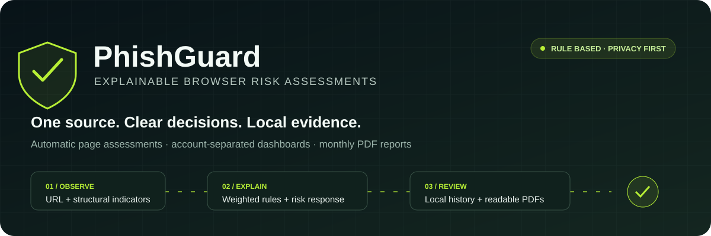
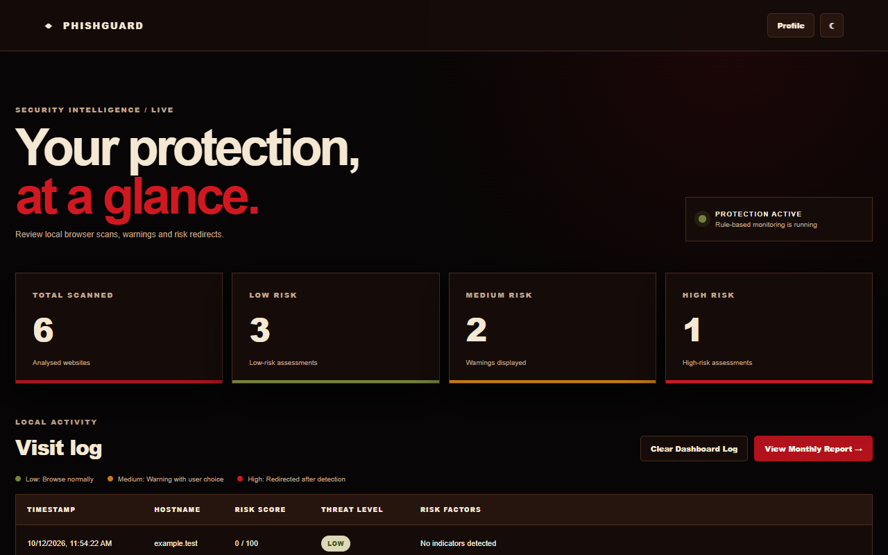
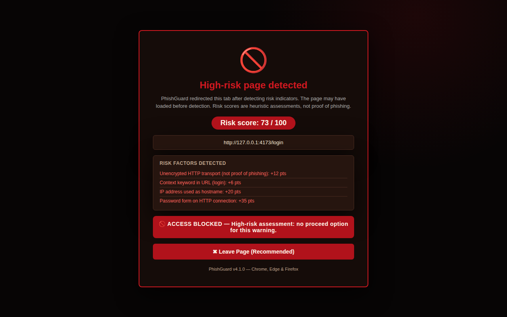
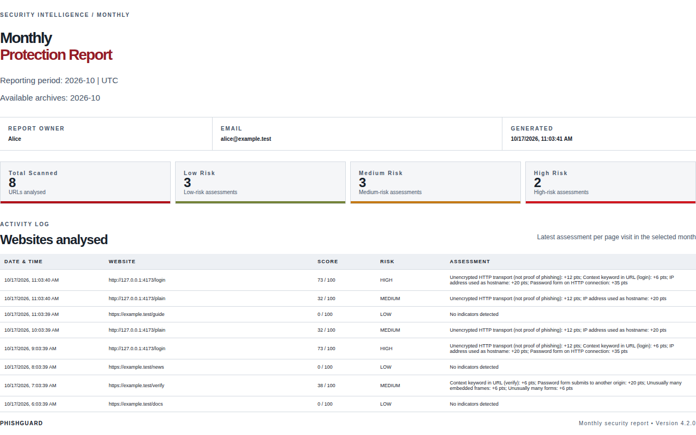
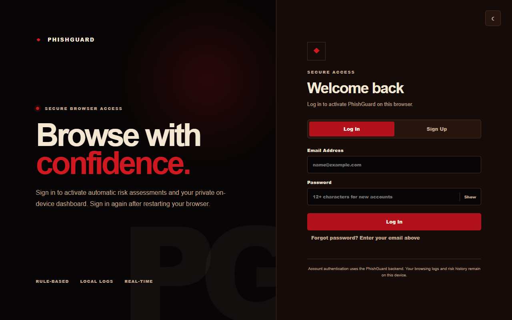
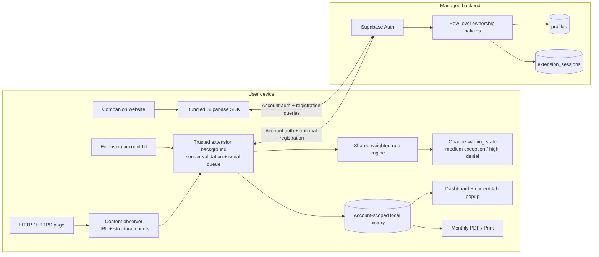
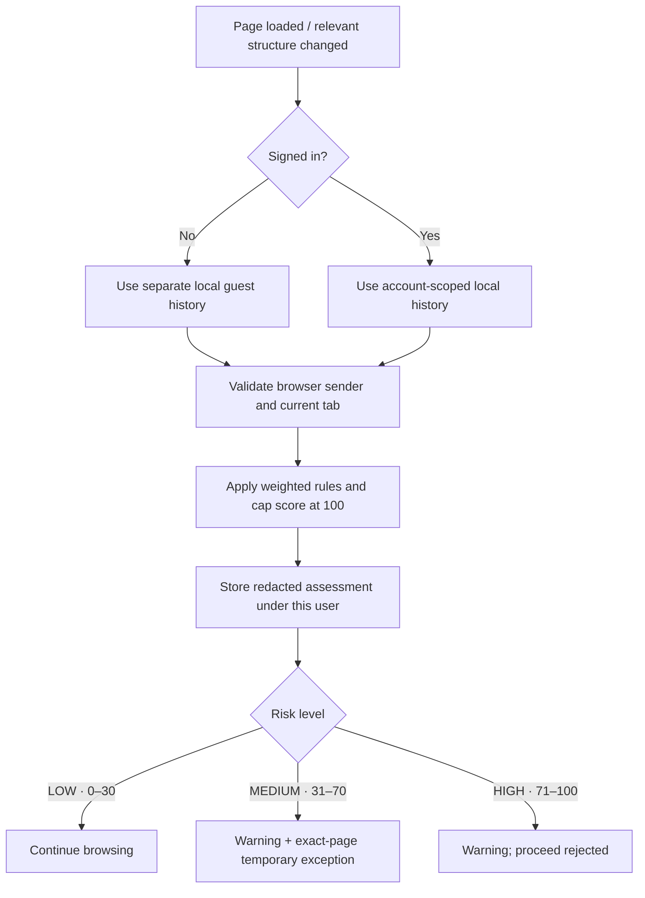
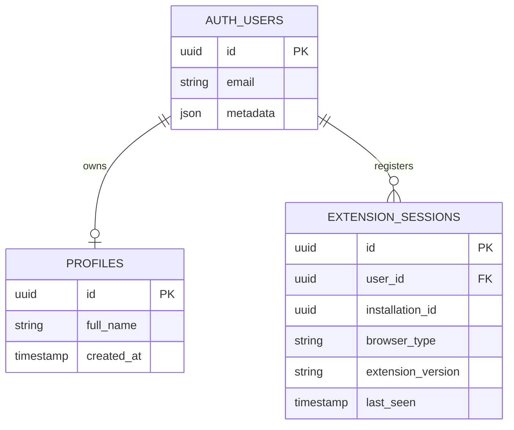

<div align="center">

**Explainable browser risk assessments. Private local evidence.**

`v4.1.0 candidate` · `Manifest V3` · `Node.js 22+` · `Supabase Auth` · `PDF reports`

[Demo](#demo) · [Architecture](#architecture) · [Quick start](#quick-start) · [Detection](#detection-model) · [Verification](#verification) · [Deployment](#deployment) · [Documentation](#documentation)

</div>

---

PhishGuard is a rule-based browser extension and companion website developed as a Final Year Project. It automatically assesses HTTP/HTTPS URLs and selected page-structure indicators, explains its risk score, redirects suspicious pages to controlled warnings, and maintains account-separated local dashboards and monthly reports.

**One maintained source repository builds Chrome/Edge and Firefox packages.** Browser targets are generated outputs of the same version; there are no parallel source copies to maintain.

> **Release status:** a locally verified implementation candidate, not a certified phishing-prevention product. Live Supabase/email/RLS checks, representative detection evaluation, physical-browser/mobile tests and store approvals remain release gates. Page assessment occurs **after loading**, so redirects cannot guarantee prevention of network requests or credential theft. [Release readiness →](docs/RELEASE-READINESS.md)

## What is implemented

| Capability            | Behaviour                                                                                                                                       |
| --------------------- | ----------------------------------------------------------------------------------------------------------------------------------------------- |
| Account onboarding    | Optional signup, email-verification requirement, login, profile editing and website password recovery                                           |
| Session handling      | Official Supabase SDK refresh; extension credentials in trusted browser-session storage; local cleanup even when logout cannot reach the server |
| Automatic assessments | Page-load scan, relevant DOM-change reassessment and URL-change polling with bounded work                                                       |
| Explainable rules     | Weighted indicators, documented thresholds and human-readable reasons                                                                           |
| Controlled warnings   | Medium risk permits an exact-page, per-tab five-minute exception; high-risk proceed requests are rejected by the background                     |
| Account privacy       | Local histories keyed by authenticated user ID; browser-registration rows protected by ownership policies                                       |
| Review and reporting  | Current-tab popup, recent-activity dashboard, month selection, paginated PDF download and a Unicode-preserving Print alternative                |
| Reproducible delivery | Locked dependencies, one build pipeline, matching package contents, SHA-256 checksums and locally bundled executable dependencies               |
| Repository quality    | Pinned CI actions, formatting checks, dependency updates, security guidance and controlled browser/accessibility checks                         |

## Demo


The animation cycles through **real application screenshots** captured with synthetic accounts and harmless fixtures. It is not a recording of live threats, real user histories or production accuracy. SVG animations respect reduced-motion preferences; the static screenshots remain available below.

<table>
<tr>
<td width="50%"><strong>Private activity dashboard</strong><br></td>
<td width="50%"><strong>Validated high-risk warning</strong><br></td>
</tr>
<tr>
<td><strong>Readable monthly report</strong><br></td>
<td><strong>Account onboarding</strong><br></td>
</tr>
</table>

Recreate the screenshots and animation with `npm run demo`. The script uses a temporary browser profile, isolated mocked Supabase and eight automated desktop accessibility checks. No live accounts or cloud records are created.

[Presentation walkthrough](docs/DEMO.md) · [Website screenshot](docs/assets/website.png) · [Medium warning](docs/assets/warning-medium.png) · [Account portal](docs/assets/account.png)

## Architecture



**Browsing history stays on the device.** Supabase manages account information and recorded browser registrations; it does not receive the local visit log. The website and extension use the same account backend but maintain separate login sessions.

### Assessment lifecycle



The background owns privileged operations and warning destinations. Query-string claims cannot change a warning's risk level or target. Content scripts receive no session tokens and privileged account messages require an extension-origin sender.

### Account data



Supabase Auth manages passwords; application tables do not duplicate them. Registration upserts use the user/installation pair. `last_seen` represents recorded login/registration activity, **not a live browser connection**. [Trust boundaries and rule rationale →](docs/ARCHITECTURE.md)

## Quick start

Requirements: **Node.js 22+**, npm, Git, and a supported desktop browser.

```bash
git clone https://github.com/hossain0707/PhishGuard.git
cd PhishGuard
npm ci
npm run build
npm test
npm run serve
```

Open **http://127.0.0.1:4173**. The website can be previewed without a real account, and the extension performs local guest-mode risk assessments without Supabase. Real signup/login still requires a working Supabase configuration.

| Browser target                  | Development installation                                                                                         |
| ------------------------------- | ---------------------------------------------------------------------------------------------------------------- |
| Chrome / Edge                   | Enable developer mode in the extension manager; load `dist/chrome-edge` unpacked                                 |
| Firefox desktop                 | Load `dist/firefox/manifest.json` temporarily through `about:debugging`; permanent installation requires signing |
| Firefox Android                 | Compatibility candidate requiring physical-device validation before distribution                                 |
| Standard Chrome mobile / Safari | This repository does not claim support; Safari requires a separate Apple packaging workflow                      |

### Configure your backend

Copy `.env.example` to `.env`, or set the same public values in Vercel:

```dotenv
PHISHGUARD_SUPABASE_URL=https://YOUR-PROJECT.supabase.co
PHISHGUARD_SUPABASE_PUBLISHABLE_KEY=sb_publishable_YOUR_PUBLIC_CLIENT_KEY
PHISHGUARD_WEBSITE_URL=https://YOUR-PROJECT.vercel.app/
```

Run `npm run build` again. Build validates the backend URL, rejects secret/service-role keys, sets both browser clients' public configuration and pins the extension connection policy to the chosen project. Generated browser configuration is excluded from Git.

Apply/review [the SQL migration](database/001_accounts.sql), enable email confirmation, configure production SMTP and exact allowed callback URLs, and verify ownership using **two real test accounts**. Without environment overrides, the historical supplied public project configuration is retained; that hostname previously failed DNS checks and is not a working live demo.

**Never place a secret/service-role key in a browser client or commit private environment files.** [Complete setup and operations guide →](docs/SETUP.md)

## Detection model

| Indicator                              | Weight |
| -------------------------------------- | -----: |
| Unencrypted HTTP connection            |    +35 |
| Suspicious keyword in URL              |    +20 |
| IPv4 / IPv6 address used as hostname   |    +25 |
| Password input on an HTTP page         |    +20 |
| More than three iframes                |    +10 |
| More than five forms                   |    +10 |
| Exact/subdomain known-domain indicator |    −30 |

Scores are capped at 100: **LOW 0–30 · MEDIUM 31–70 · HIGH 71–100**. Domain matching uses a proper boundary, so `evilgoogle.com` does not match `google.com`.

These are **heuristics, not probabilities**. HTTPS phishing pages can score LOW, legitimate login pages can trigger keywords, and a known-domain discount does not prove safety. Dynamic work is limited to 100 assessments per rolling ten-minute window, with debounced mutation handling and URL polling. The synthetic evaluation contains intentional false positives and false negatives; it must not be reported as real-world accuracy.

## Privacy and security

- No password values, form contents or page text are captured.
- Persisted assessment URLs omit credentials, query strings and fragments; paths may still contain personal information.
- Histories are local, separated by account and bounded to 5,000 assessments / 366 days, subject to storage capacity.
- Dashboard Clear preserves report history; explicit month deletion and account-history erasure remove owned records.
- Extension tokens live in browser-session storage; restarting the browser requires login. Website sessions use local browser storage.
- Cloud account tables use owner-based RLS. Firefox browser metadata registration requires optional technical-data consent.
- Logout clears local credentials even when remote cleanup fails; offline cleanup does not prove server-side session revocation.
- Exported PDFs remain separate files until the user deletes them.

The extension can scan in guest mode when authentication is unavailable. Guest history uses its own on-device owner key and is not silently merged into an account. The extension requests `storage`, `tabs` and HTTP/HTTPS site access. Executable dependencies are bundled locally; extension pages use a restrictive CSP and are not exposed as web-accessible account pages.

[Security reporting](SECURITY.md) · [Product privacy disclosure](website/privacy.html) · [Release requirements](docs/RELEASE-READINESS.md)

## Verification

```bash
npm run check
npm audit --omit=dev
npm run evaluate
npm run demo
```

Windows browser checks default to installed Edge. On Linux/macOS, install Playwright Chromium:

```bash
npx playwright install --with-deps chromium
```

Override the selected browser with `TEST_BROWSER_CHANNEL` when needed.

| Layer                | Coverage                                                                                                                                    | Evidence boundary                                            |
| -------------------- | ------------------------------------------------------------------------------------------------------------------------------------------- | ------------------------------------------------------------ |
| Unit / integration   | Rule boundaries, redaction, retention, month selection, PDF pagination, SDK refresh/revocation, offline logout and safe build configuration | Local code behaviour                                         |
| Database             | Actual SQL/RLS in local PostgreSQL-compatible PGlite, including two-account denials and pre-existing permissive policies                    | Migration logic; deployed Supabase must be tested separately |
| Browser              | Signup/login, recovery, dynamic reassessment, warnings, ownership, deletion, PDFs and responsive layout                                     | Real browser UI with mocked Supabase                         |
| Accessibility        | Eight controlled desktop screens checked with axe WCAG A/AA tags                                                                            | Automated checks, not a complete accessibility certification |
| Package / repository | ZIP entries match generated sources; outputs, dependencies and private environment files stay out of Git                                    | Reproducible delivery                                        |
| CI                   | Formatting, build, tests, Firefox validation, browser scenarios, demo checks and production dependency audit                                | Remote run status available in the repository Actions tab    |

The GitHub workflow uses pinned action revisions, read-only job permissions and CI logs (artifact uploads disabled while quota is exhausted). Dependency updates are proposed through Dependabot. No live credentials are required by CI.

## Repository layout

```text
PhishGuard/
├── extension/
│   ├── src/               Background and extension-page logic
│   ├── pages/             Maintained HTML/CSS templates
│   ├── assets/            Store-size icons
│   └── manifest.json      Browser manifest template
├── website/
│   ├── src/               Authored website behaviour
│   └── …                  Maintained pages and visual assets
├── shared/                Auth, rules, history, logout, PDFs and config
├── database/              Reviewed SQL migrations
├── docs/                  Architecture, evidence, demo and operations
├── tests/                 Controlled automated verification
├── tools/                 Build, demo, server and evaluation helpers
├── .github/               CI, dependency updates and PR guidance
├── .env.example           Public-client configuration template
├── package-lock.json      Reproducible dependency versions
└── vercel.json            Root deployment configuration
```

`dist/`, `node_modules/`, `test-results/` and generated website bundles/downloads are excluded from Git. Build produces browser packages in `dist/chrome-edge` and `dist/firefox`, plus website ZIP downloads and SHA-256 checksums. **Do not maintain a second copy or upload source ZIPs as the repository.**

## Deployment

Import **this repository root** into Vercel using the **Other** framework preset. Root `vercel.json` installs locked build dependencies, runs `npm run build` and publishes `website`. Set the three public configuration values in the deployment environment, rebuild, and allow the exact production Auth callback.

A stable HTTPS Vercel URL is sufficient for an academic demonstration; a custom domain is optional. Store packages need separate browser review/signing. Do not describe a development ZIP as a store-approved release.

Before public release: restore/configure the live Supabase project, verify email and deployed ownership policies, provide a real operator/privacy contact, test supported browsers/devices, complete a representative holdout evaluation, obtain approved institutional branding and finish store approvals. [Free Vercel deployment handoff →](docs/DEPLOY-VERCEL-FREE.md) · [Branding handoff →](docs/BRANDING.md) · [Publishing and mobile feasibility →](docs/PUBLISHING.md) · [Free Edge/Firefox store listing package →](docs/STORE-SUBMISSIONS.md)

## Documentation

| Document                                               | Purpose                                                             |
| ------------------------------------------------------ | ------------------------------------------------------------------- |
| [Architecture](docs/ARCHITECTURE.md)                   | Data flow, trust boundaries, rule catalogue and privacy model       |
| [Setup and operations](docs/SETUP.md)                  | Supabase schema, authentication, callbacks, deployment and rollback |
| [User guide](docs/USER-GUIDE.md)                       | Installation, account flows, warnings, history and reports          |
| [Demo guide](docs/DEMO.md)                             | Repeatable capture and presentation walkthrough                     |
| [Test plan](docs/TEST-PLAN.md)                         | Automated checks, real-service acceptance and evaluation design     |
| [FYP evidence](docs/FYP-EVIDENCE.md)                   | Requirements, technical evidence and automation limitations         |
| [Implementation report](docs/IMPLEMENTATION-REPORT.md) | Recorded work and verification scope                                |
| [Release readiness](docs/RELEASE-READINESS.md)         | Unverified external production gates                                |
| [Contributing](CONTRIBUTING.md)                        | Development workflow and review expectations                        |
| [Security](SECURITY.md)                                | Private vulnerability reporting and sensitive-data handling         |
| [Changelog](CHANGELOG.md)                              | Implementation-candidate changes                                    |

**Academic context:** German-Malaysian Institute FYP 2026; institutional logo/branding approval remains pending. **Licensing:** no open-source redistribution licence has been declared for project source. Bundled dependencies retain their own notices; do not assume the repository has an MIT licence.
